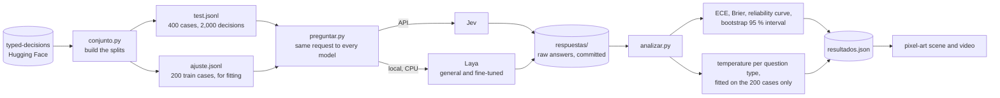

# laya-vs-jev: a calibration eval for typed-decision models

[](https://github.com/jupiutrera/laya-vs-jev/actions/workflows/ci.yml)
[](LICENSE)

When a model says it is 90 % sure, is it right 9 times out of 10? This repository measures that for three models on the same 2,000 decisions, shows how much a held-out temperature fit repairs, and shows that the usual summary number (ECE) moves by a factor of eight depending on how it is computed.

[Versión en español](README.es.md)

## The problem

A model that returns a decision with a probability is only useful in an automated workflow if the probability means something: a threshold such as "act without review above 80 %" assumes it does.

The two models compared here publish calibration figures that cannot be compared with each other:

- **Laya** reports an expected calibration error (ECE) of 0.466 out of the box and 0.081 after temperature scaling.
- **Jev** has two published figures that disagree: 0.246 in a third-party comparison and 0.144 in the typed-decisions dataset card.

None of those numbers come with the script that produced them. This eval puts the same questions to every model, stores every raw answer, and computes everything with one script.

## How it works



- **Dataset.** [typed-decisions](https://huggingface.co/datasets/LocalLLaMA/typed-decisions), `test` split: 400 cases from four workflows (agent trace observability, customer service, invoice processing, security incidents), five questions each (yes/no, choice and score). A decision is right when it matches the gold label.
- **Same request for every model.** The case `state` and its five `questions`, exactly as they come in the dataset.
  - Jev: TypeSafe API, `jev-latest`, which answered as `jev-1.13.0`.
  - Laya, general: [`convaiinnovations/laya`](https://huggingface.co/convaiinnovations/laya) with `laya` 0.3.28, run locally on CPU.
  - Laya, fine-tuned: [`convaiinnovations/laya-typed-decisions`](https://huggingface.co/convaiinnovations/laya-typed-decisions), trained on the `train` split of this dataset.
- **Confidence** is the probability of the option the model chose. **ECE** uses 10 equal-width bins weighted by the number of decisions.
- **Refit.** One temperature per question type and number of options, fitted by maximum likelihood on 200 cases of `train` (50 per workflow). A test checks that none of them is in the test split.
- **Three states for each Laya.** Raw (its shipped temperatures undone), as shipped, and refitted. Jev exposes no temperature, so it has two: as served and refitted.
- **Uncertainty.** 95 % intervals come from 1,000 bootstrap resamples of whole cases, because the five decisions of a case are not independent.

The measurement code is in `medir/` and its identifiers and JSON keys are in Spanish; the tests in `tests/` are in English and start with a short glossary.

## Run it

Every raw model answer is committed, so the results can be recomputed with no API key and no model download. With [uv](https://docs.astral.sh/uv/) installed:

```bash
uv run medir/analizar.py
```

That rewrites `datos/resultados.json` from `datos/respuestas/`. It takes about a minute, almost all of it the bootstrap, and `git diff` shows nothing afterwards. CI runs the same check on every push.

The tests:

```bash
uv run --with-requirements requirements-dev.txt pytest
```

To ask the models again (Python 3.12; Jev needs an API key, Laya takes about 8 s per case on a laptop CPU):

```bash
python -m venv .py && .py/Scripts/python -m pip install -r requirements.txt
cp .env.example .env                          # TYPESAFE_API_KEY or AI_GATEWAY_API_KEY
.py/Scripts/python medir/conjunto.py          # datos/test.jsonl and datos/ajuste.jsonl
.py/Scripts/python medir/preguntar.py jev     # resumable
.py/Scripts/python medir/preguntar.py laya
.py/Scripts/python medir/preguntar.py laya-td # the fine-tuned Laya
```

The scene that tells the result as a one-minute pixel-art video (text in Spanish):

```bash
npm install && npm run dev                    # http://localhost:5173, space to start
```

## Results

2,000 decisions per model, measured in October 2026. Full output in [`datos/resultados.json`](datos/resultados.json).

| | Laya, general | Laya, fine-tuned | Jev |
|---|---|---|---|
| Accuracy | 36.2 % | 76.6 % | 73.4 % |
| ECE, raw | 0.266 | 0.128 | n/a |
| **ECE, as shipped** | **0.175** (95 % CI 0.152 to 0.199) | **0.213** (0.194 to 0.232) | **0.036** (0.023 to 0.054) |
| ECE, refitted on 200 held-out cases | 0.035 | 0.061 | 0.032 |
| Mean confidence, as shipped | 53.6 % | 55.3 % | 75.2 % |
| Accuracy when it says 80 % or more | 41.4 % (116 answers) | 99.5 % (206 answers) | 88.3 % (901 answers) |
| Brier score, as shipped | 0.750 | 0.400 | 0.366 |

What the table says:

- **Laya, general, promises more than it delivers.** It is right 36 % of the time and says 54 % on average. When it says 80 % or more it is right 41 % of the time.
- **Laya, fine-tuned, is the most accurate and promises less than it delivers.** Its shipped temperatures flatten it too much: without them its ECE is 0.128, with them 0.213. Underconfidence is still miscalibration, and it means a threshold set at 80 % sends answers to review that did not need it.
- **Jev is calibrated as served**, and refitting barely moves it (0.036 to 0.032).
- **A 200-case temperature fit removes most of the error** for the general Laya (0.175 to 0.035) without changing a single answer. It does nothing for accuracy.

The accuracy (0.766) and as-shipped ECE (0.213) measured for the fine-tuned Laya match its model card, as does the 0.175 of the general one.

### One set of answers, eight ECE values

The same Jev answers, scored with eight recipes that are all used in practice:

| How the ECE is computed | Jev, as served |
|---|---|
| Top option, 10 equal-width bins (the one used above) | 0.036 |
| Top option, 15 equal-width bins | 0.044 |
| Top option, 10 equal-mass bins | 0.035 |
| The model's own `confidence` field instead of the top probability | 0.041 |
| Every option of every question, not only the chosen one | 0.021 |
| Against the dataset's soft gold probabilities instead of the hard label | 0.169 |
| ECE per question, then averaged, 10 bins | 0.117 |
| ECE per question, then averaged, 15 bins | 0.131 |

From 0.021 to 0.169 without changing a single answer. None of the eight reproduces the three figures of the typed-decisions card at once (uniform, prior and Jev), and the script behind that card is not published.

## Limitations

- One dataset, and a synthetic one: its gold labels were produced by a model of about 4B parameters.
- The models do not compete on equal terms. The general Laya and Jev were not trained on this dataset; the fine-tuned Laya was, on `train`. The dataset card separates the two kinds of model for that reason.
- Latency is not comparable and is not reported as a result: Laya ran on a laptop CPU (median 9.6 s per case) and Jev through an API (median 1.2 s).
- Jev rounds probabilities to two decimals. A reported 0.00 is read as "below 0.005" so that the log-likelihood used in the temperature fit stays finite.
- One run per model. The intervals cover sampling of cases, not run-to-run variation of the models.
- After the refit the general Laya never says 80 % or more, so its high-confidence row would be empty: calibration was bought by giving up confident answers, which says the model has little signal on this task.

## What I learned

- An ECE without its recipe is not a measurement. Binning, which probability counts as the confidence and whether the gold is hard or soft moved the same answers from 0.021 to 0.169. Comparing two published ECEs is only safe when both come from the same script.
- Storing the raw answers is what makes the eval checkable. Every number here is recomputed in CI from committed files, so a change to the analysis that moves a result shows up as a diff.
- Calibration and accuracy are separate properties and have to be reported together. A model can be well calibrated and wrong most of the time (the general Laya after refitting, 36 % accurate with an ECE of 0.035).
- Shipped calibration parameters deserve the same suspicion as shipped weights. The fine-tuned Laya is better calibrated with its temperatures removed.
- The unit of resampling is a design decision. The five questions of a case share one context, so the intervals resample whole cases; resampling single decisions would treat them as independent.

## License

[MIT](LICENSE). The dataset and the models belong to their authors; see the links above for their terms.
